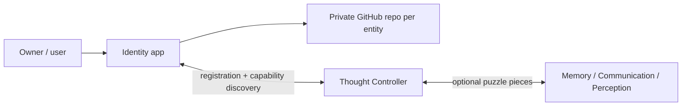

# Identity — local Identity Manager (Gate 1 prototype)

> **This branch: `experiment/identity-local-v1-20261023`** — a small working app that **creates, saves, lists/opens and restores** local test identities. Built from `alpha` for [Issue #2](https://github.com/Arameair/identity/issues/2). **No GitHub, no Thought Controller, no accounts, no AI.** Owner test report: [docs/OWNER_TEST_REPORT.md](docs/OWNER_TEST_REPORT.md).

## Run it in Project Controller

1. Open Project Controller → **Arameair/identity** → branch **`experiment/identity-local-v1-20261023`** → **Play** (approve the build plan: `go build -o identity .`, then `./identity`).
2. The page shows the **branch, full commit and data folder** at the top.
3. **Stop** ends it completely; **Play** again restores everything from the same data folder.

Needs Go 1.22 or newer (`go.mod` says `go 1.22.0`, so an older Go fetches a valid toolchain).

## What you can do

- **Create an identity:** a display name plus a type (AI companion, Business, Person, Project, Other). A permanent random ID (UUID) is made once. Nothing else is asked.
- **See saved identities** as cards. **Open** one for its full ID (**Copy ID**), type, creation time, schema version and save status.
- **Future pieces** are plain labels: GitHub **NOT CONFIGURED**, Thought Controller **NOT CONNECTED**, Memory / Discord / other **NOT CONFIGURED**. The app makes no external requests.
- **Copy Diagnostics** gives branch, commit, data folder, IDs, types, problem files and recent events. **Names are left out.** No credentials exist in this app.
- **Failure tests** (folded at the bottom) are for acceptance F: "Make the next save fail", "Add a broken record file", "Remove broken test files". They touch only this app's test data folder.

## Where the data lives

| Priority | Source | Folder used |
|---|---|---|
| 1 | `-data DIR` flag | `DIR` |
| 2 | `IDENTITY_DATA` | that folder |
| 3 | Project Controller's `PC_DATA` | `$PC_DATA/identity` |
| 4 | none (standalone run) | `~/.identity-test/<branch>`, or `commit-<sha>` for a detached checkout with no branch |

- **Inside:** `identities/<id>.json` (one file per identity), `events.jsonl` (what happened) and `identity.lock` (while running).
- **Never in the repo:** a data folder inside the code checkout is refused at startup.
- **One app per folder:** a second Identity app pointed at the same folder refuses to start. A different folder runs independently.
- **Branch name:** comes from `PC_BRANCH` (Project Controller's detached checkouts), else git. The commit comes from git.

## How it stays reliable

- **Saving:** each save writes a temp file, flushes it to disk, renames it into place, then **reads it back**. Only then does the page say "Saved". A failed save shows an error, adds no card, and leaves every earlier identity untouched.
- **Never overwritten:** an existing identity file is never replaced, and IDs are never reused.
- **Broken files:** unreadable, mismatched or unsupported files are listed under "Files that couldn't be loaded" and **left exactly as they are**. Good identities still load.
- **Repeats:** a double-clicked or repeated Create returns the same identity instead of a second one. Creating the same name and type again asks first.
- **Access:** loopback only (127.0.0.1). Other web pages can't post to it. Unknown request fields are rejected, so a caller can't choose an ID.
- **Stopping:** Stop (SIGTERM / Ctrl+C) shuts down cleanly, removes the lock, and leaves no background process.

## Tests

`go test ./...` runs 18 tests, including one that **builds and runs the real program**: Play → create TASS → Stop → Play → same TASS → create a business → a second instance on its own folder → same-folder refusal → Stop each → restore again.

---

# Identity — reusable entity and account manager

> **Status: project blueprint, not a working account manager.** No GitHub/Discord credentials, logins, Thought Controller registration, or provisioning are implemented.

**Identity** is the independent setup and continuity component of the Thought Controller ecosystem. It can create or restore a uniquely identified **entity** (AI companion, person, business, team, project, etc.), guide its user through GitHub repository setup, manage access through secure local credentials, and register capabilities with a compatible Thought Controller. **Personality and thinking are optional modules, not part of the definition of identity.**

## Start here: click through the project

The detailed, clickable proposal is on the **design experiment branch**, not yet approved/promoted to Alpha:

**[▶ Open the Identity project guide](https://github.com/Arameair/identity/blob/experiment/design-foundation-20261023/README.md)**

That guide links to the vision, step-by-step first-run wizard, entity model, account/security plan, Thought Controller handshake, examples, decisions, test gates and implementation instructions.

## Core principle

One reusable **Identity application** can create or restore many separate **entity identities**. Each entity is associated with its own **private GitHub repository** as a non-secret environment blueprint, while its local identity state and credentials stay outside code checkout folders. A GitHub *account* may securely own more than one entity repository; creating an entity does not mean automating creation of a new GitHub user account.

**Safety:** passwords, MFA codes, access tokens, API keys, private keys, and session cookies never belong in GitHub, even private repositories. The planned account manager uses a protected local secrets store and user-approved limited access.

## Project rules

- `main`: bootstrapped public-facing README (the repo itself is currently **private**).
- `alpha`: owner-controlled baseline.
- `experiment/*`: unapproved prototypes and design proposals.
- `stable`: optional later snapshot of an approved Alpha.
- **Never auto-promote** experimental work to Alpha/main or imply that a design is implemented.
- Independent lifecycle and observable diagnostics when eventually run through [Project Controller](https://github.com/Arameair/Project-controller).
- [Thought Controller's repair/test plan](https://github.com/Arameair/Thought-Controller/issues/3) remains the prerequisite for live integration.

This is a planning repository. See the design-branch guide for proposed implementation and acceptance criteria.
