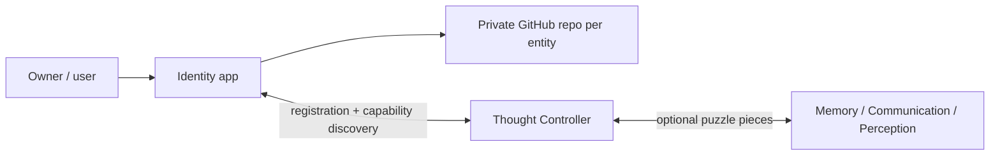

# Identity — reusable entity and account manager

> **Status: project blueprint, not a working account manager.** No GitHub/Discord credentials, logins, Thought Controller registration, or provisioning are implemented.

**Identity** is the independent setup and continuity component of the Thought Controller ecosystem. It can create or restore a uniquely identified **entity** (AI companion, person, business, team, project, etc.), guide its user through GitHub repository setup, manage access through secure local credentials, and register capabilities with a compatible Thought Controller. **Personality and thinking are optional modules, not part of the definition of identity.**

## New owner direction — Identity is the heart of the system (2026-10-24)

**Identity is more than a companion/account manager: each independently developed feature should also have its own identity.** Identity provides the authoritative understanding of which participants exist, their capabilities, their relationships, and their trust and permissions. This makes Identity the **system-level “brains” behind Thought Processor's connection and control experience**—while cognitive thought processing remains the job of Thought Engine.

**[Read the Identity-first system model, terminology, unchosen relationship options and next discussion questions](docs/IDENTITY_FIRST_SYSTEM_MODEL.md).**

The owner has **not** selected whether feature identities are owned hierarchically by companions or remain independent with permissioned relationships. Those alternatives are explicitly open. The original notes below remain useful as narrower earlier decisions, and nothing is implemented by this clarification.

## Current Identity ↔ Thought Processor direction (2026-10-23, design only)

The owner has selected a modular architecture in which **Identity and Thought Processor are independently runnable, closely integrated applications**. Identity owns durable entity identities, trusted service pairing, feature grants and revocation; Thought Processor discovers compatible projects, presents their genuine app UIs and supports lightweight diagnostics. **Each receiving application must enforce scoped permissions**, and private AI/feature operations do not need to pass through Processor.

**Read the new notes:**

- **[Identity ↔ Thought Processor — architecture and agreed integration choices](docs/THOUGHT_PROCESSOR_INTEGRATION.md)**: small core + optional capabilities, hybrid discovery, pairing, approvals, hybrid health, distributed traces and real dynamic cards.
- **[Trust, authorization and bootstrap](docs/IDENTITY_PROCESSOR_TRUST_AND_BOOTSTRAP.md)**: discovery vs pairing vs grants, Identity-first startup, short-lived offline authorizations, failure states and outstanding security decisions.

These notes are on **`experiment/processor-identity-connection-notes-20261023`**, created from Alpha `8d08fec6629dc9cc35ea2266556572b86e5499d7`. **They do not implement a service, approve an API, or promote the branch.** References below to the older Thought Controller concept remain historical until a deliberate, separately reviewed migration. **Project Controller is the owner's optional development dashboard; it is not a required component for end users or other developers.**

## Start here: click through the project

The detailed, clickable proposal is on the **design experiment branch**, not yet approved/promoted to Alpha:

**[▶ Open the Identity project guide](https://github.com/Arameair/identity/blob/experiment/design-foundation-20261023/README.md)**

That guide links to the vision, step-by-step first-run wizard, entity model, account/security plan, Thought Controller handshake, examples, decisions, test gates and implementation instructions.

## Core principle

One reusable **Identity application** can create or restore many separate **entity identities**. Each entity is associated with its own **private GitHub repository** as a non-secret environment blueprint, while its local identity state and credentials stay outside code checkout folders. A GitHub *account* may securely own more than one entity repository; creating an entity does not mean automating creation of a new GitHub user account.

**Safety:** passwords, MFA codes, access tokens, API keys, private keys, and session cookies never belong in GitHub, even private repositories. The planned account manager uses a protected local secrets store and user-approved limited access.

## Project rules

- `main`: bootstrapped public-facing README (the repo itself is currently **private**).
- `alpha`: owner-controlled baseline.
- `experiment/*`: unapproved prototypes and design proposals.
- `stable`: optional later snapshot of an approved Alpha.
- **Never auto-promote** experimental work to Alpha/main or imply that a design is implemented.
- Independent lifecycle and observable diagnostics when eventually run through [Project Controller](https://github.com/Arameair/Project-controller).
- [Thought Controller's repair/test plan](https://github.com/Arameair/Thought-Controller/issues/3) remains the prerequisite for live integration.

This is a planning repository. See the design-branch guide for proposed implementation and acceptance criteria.
