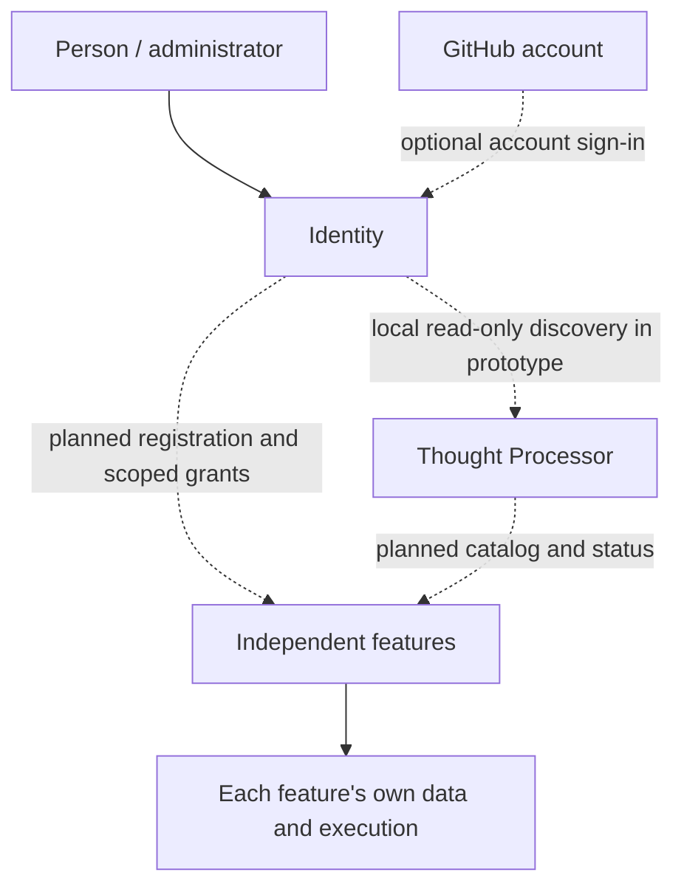

# Identity

**A local-first identity and capability foundation for independently running software features.**

**Status: active prototype development — not a released identity/security platform.** Updated October 25, 2026. This `main` branch is the **public project and documentation entry point**; executable Go prototypes live on experimental branches.

Identity explores a practical question: **How can separate applications recognize participants, advertise available capabilities, and eventually enforce access decisions without becoming one tightly coupled program?**

> **Guiding principle:** Identity organizes who and what belongs to the system, and what each participant is authorized to access. **Each feature owns its own execution, data and logs.**

[**Try the current prototype**](docs/TRY_THE_PROTOTYPE.md) · [**See what actually works**](docs/STATUS.md) · [**Read the engineering case study**](docs/PROJECT_JOURNEY.md)

## Why this project exists

A companion, a Thought Processor, a memory feature, and future tools may operate as separate processes and evolve independently. They need to distinguish:

- **Identity:** a durable entity, person, service or project identifier.
- **Account:** a separately authenticated external account, such as a GitHub user.
- **Feature:** a capability that may be installed, visible or available.
- **Runtime:** a particular instance that is running now.
- **Authorization:** a specific operation the caller has permission to perform.

These are **not interchangeable**. A program answering on a local port does not make it a trusted peer. A GitHub login or visible feature repository does not automatically grant feature access.

Identity is intended to be the system's organizing and trust foundation—not the reasoning engine, a central log collector, a replacement for Memory, or a required process supervisor.

## How the pieces fit



**Diagram key:** solid arrows represent conceptual ownership or direct user interaction; dashed arrows include optional integrations and explicitly planned relationships. In the current prototype, Processor detection is **self-reported and unverified**, not authenticated pairing.

[Identity-first design](docs/IDENTITY_FIRST_MODEL.md) · [System architecture](docs/ARCHITECTURE.md) · [Security boundaries](docs/SECURITY.md)

## Current progress

| Area | October 25 position |
| --- | --- |
| Core vision and responsibilities | Documented on `main`; open design questions are tracked |
| Runnable standalone Identity UI | **Go code present in experimental branches**, not on `main` |
| GitHub device sign-in and feature visibility | Implemented as candidate code; test fixtures and some development observations exist, but the most recent owner-acceptance state is **pending** |
| Local Thought Processor detection | Candidate has a read-only probe; no authenticated service-pairing contract |
| Local profile, persistent activity log and Copy Diagnostics | Candidate implementation and prototype test reports; independently verify on the target machine |
| Actual feature requests, scoped grants and cross-service enforcement | **Not implemented / not verified** |
| General release / `stable` | **No approved public release established** |

The [October 25 Alpha candidate](https://github.com/Arameair/identity/tree/alpha-candidate-20261025) records fixes to GitHub polling, stale sign-in codes, missing feedback, UI panel state, built-in publisher configuration, diagnostic labeling and port collisions. **Those are candidate claims until the owner verifies the result.** Earlier [Prototype B results](https://github.com/Arameair/identity/blob/experiment/identity-home-claude-20261025/docs/HOME_TRIAL_EVIDENCE_CLAUDE.md) include real development-Linux process testing and separately labeled GitHub fixtures, not a verified owner Windows acceptance test.

[Detailed status and evidence](docs/STATUS.md) · [Roadmap](docs/ROADMAP.md)

## Try it on your computer

There is **no production installer to download from `main`**. For a reproducible Windows experiment, use the documented candidate. You need Git, Go 1.22+, and PowerShell; Project Controller is **not** required.

```powershell
git clone --branch alpha-candidate-20261025 https://github.com/Arameair/identity.git
cd identity
.\scripts\build-windows.ps1
.\identity.exe
```

This should start Identity locally and open a browser-based first-run experience. GitHub connection is optional to run the local UI, but required for the candidate's live GitHub-account visibility test. A separate [Thought Processor](https://github.com/Arameair/Thought-Processor) process is only required to test their interaction.

**Do not share the private `#key=` opening link, GitHub device codes, authentication tokens or session cookies.** A feature appearing as available is not the same as being granted.

For prerequisites, full two-program instructions, expected and failure states, diagnostics and safe rollback, **follow [Try the prototype](docs/TRY_THE_PROTOTYPE.md)**.

## Explore the engineering work

| Your question | Best place to start |
| --- | --- |
| What problem is this solving, and which choices were made? | [Engineering case study](docs/PROJECT_JOURNEY.md) |
| What works, what was tested, and what remains uncertain? | [Status and branch ledger](docs/STATUS.md) |
| How are Identity, Processor and independent features separated? | [Architecture](docs/ARCHITECTURE.md) and [Identity-first model](docs/IDENTITY_FIRST_MODEL.md) |
| How should a brand-new user experience this? | [Prototype trial](docs/TRY_THE_PROTOTYPE.md) and [target first-run design](docs/FIRST_RUN.md) |
| How will security, storage and grants work? | [Security](docs/SECURITY.md), [Storage](docs/STORAGE.md), [proposed interfaces](docs/INTERFACES.md) |
| What is the implementation plan? | [Roadmap](docs/ROADMAP.md), [decisions](docs/DECISIONS.md), [independent review](docs/REVIEW.md) |
| How are changes tested and promoted? | [Branch workflow](docs/WORKFLOW.md), [test report template](docs/EXPERIMENT_TEMPLATE.md) |
| Where is the full documentation index? | [Documentation guide](docs/README.md) |

## Branches and collaboration

- **`main`** — public explanation, review material and future release documentation. Today it is **documentation-only**.
- **`alpha`** — owner-controlled starting point for new functional work; currently an older baseline rather than a released app.
- **`experiment/*` and named candidates** — isolated implementations and comparisons; work is **not approved automatically**.
- **`stable`** — reserved for a known-good, explicitly approved snapshot; do not assume it exists.

Functional experiments start from Alpha. The human owner reviews evidence and explicitly chooses what, if anything, is promoted. **Documentation updates to `main` do not promote code or grant permissions.** See [Workflow](docs/WORKFLOW.md).

This project is **human-directed, AI-assisted**. AI contributions may include design, critique, documentation and code, but all claims of functionality require reproducible evidence and a human acceptance decision. [Collaboration disclosure](docs/AI_COLLABORATION.md).

**Security notice:** This repository and its experimental implementations are not an audited security boundary. Never commit credentials or sensitive logs. Do not rely on discovery or experimental authorization labels to secure a real service.
