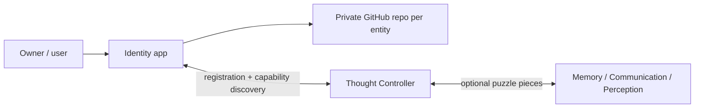

> **Experiment branch `experiment/identity-home-claude-20261025` — Identity Prototype B (Claude).** A runnable standalone Identity for the 2026-10-26 home trial: **[start here](TRIAL_START_HERE_CLAUDE.md)** · [evidence & acceptance](docs/HOME_TRIAL_EVIDENCE_CLAUDE.md) · [consolidation decisions](docs/CONSOLIDATION_DECISIONS.md). The blueprint text below is from `alpha` and unchanged.

# Identity — reusable entity and account manager

> **Status: project blueprint, not a working account manager.** No GitHub/Discord credentials, logins, Thought Controller registration, or provisioning are implemented.

**Identity** is the independent setup and continuity component of the Thought Controller ecosystem. It can create or restore a uniquely identified **entity** (AI companion, person, business, team, project, etc.), guide its user through GitHub repository setup, manage access through secure local credentials, and register capabilities with a compatible Thought Controller. **Personality and thinking are optional modules, not part of the definition of identity.**

## Start here: click through the project

The detailed, clickable proposal is on the **design experiment branch**, not yet approved/promoted to Alpha:

**[▶ Open the Identity project guide](https://github.com/Arameair/identity/blob/experiment/design-foundation-20261023/README.md)**

That guide links to the vision, step-by-step first-run wizard, entity model, account/security plan, Thought Controller handshake, examples, decisions, test gates and implementation instructions.

## Core principle

One reusable **Identity application** can create or restore many separate **entity identities**. Each entity is associated with its own **private GitHub repository** as a non-secret environment blueprint, while its local identity state and credentials stay outside code checkout folders. A GitHub *account* may securely own more than one entity repository; creating an entity does not mean automating creation of a new GitHub user account.

**Safety:** passwords, MFA codes, access tokens, API keys, private keys, and session cookies never belong in GitHub, even private repositories. The planned account manager uses a protected local secrets store and user-approved limited access.

## Project rules

- `main`: bootstrapped public-facing README (the repo itself is currently **private**).
- `alpha`: owner-controlled baseline.
- `experiment/*`: unapproved prototypes and design proposals.
- `stable`: optional later snapshot of an approved Alpha.
- **Never auto-promote** experimental work to Alpha/main or imply that a design is implemented.
- Independent lifecycle and observable diagnostics when eventually run through [Project Controller](https://github.com/Arameair/Project-controller).
- [Thought Controller's repair/test plan](https://github.com/Arameair/Thought-Controller/issues/3) remains the prerequisite for live integration.

This is a planning repository. See the design-branch guide for proposed implementation and acceptance criteria.
