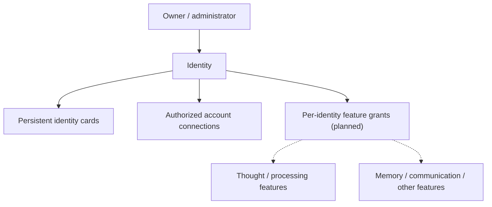

# Identity

**A stable identity and access foundation for modular software.**

Identity is a project for giving people, AI companions, businesses, projects, and services a consistent identity—without requiring them all to use the same features.

An identity answers **who or what something is**. Separately approved capabilities determine **what it is allowed to do**. The goal is to make independently developed components easier to connect, secure, replace, and restore.

> **Project status:** Active development. This `main` branch is the project introduction, **not** a production-ready application or release. Working functionality is being evaluated on experimental branches.

## Why Identity exists

As the wider ecosystem grows, each component should not have to invent its own account management, permissions, or identity records. Identity aims to provide one consistent foundation while allowing specialized features to evolve independently.

The intended design includes:

- **Persistent identity cards:** Stable identifiers and non-secret records for different kinds of entities.
- **Account connections:** One controlled place to manage authorized external accounts, including GitHub.
- **Optional features:** Explicit, per-identity permission to use capabilities such as Thought, Memory, or communication tools.
- **Continuity:** Restore the same identity across restarts and software changes rather than silently creating a replacement.
- **Clear boundaries:** Identity manages identity and authorization; each feature manages its own work and enforces the grants it receives.

An AI companion may have Thought enabled. A business identity may never need it. Both should be valid identities.

## How it fits together

Identity is **not** itself a thinking engine, chatbot, memory store, or general-purpose process controller. It is intended to work alongside independent services—including Thought and its controller interfaces—without taking over their internal responsibilities.

The diagram shows the **target architecture**, not a claim that every connection already works.

## What works today

A [standalone Go prototype](https://github.com/Arameair/identity/tree/experiment/identity-controller-port-discovery-20261023) is available on an **unapproved experimental branch**. Its source includes:

- Local creation, archiving, restoration, and persistence of identity cards with stable IDs.
- Verification of an existing GitHub CLI sign-in and read-only association with an existing private repository.
- Read-only discovery of a locally running Thought Controller by its health response.

These are experimental capabilities, **not a finished security or account-brokering product**. The prototype does not create or delete GitHub repositories. It does not implement authenticated feature grants, full in-app GitHub authorization, or a secure Thought-service handshake.

Actual user-environment acceptance and promotion are separate from a successful build or unit test.

## Explore the project

| Start here | What you'll find |
| --- | --- |
| [Current prototype and setup](https://github.com/Arameair/identity/tree/experiment/identity-controller-port-discovery-20261023) | Experimental Go application, capabilities, limits, and run instructions |
| [Design foundation](https://github.com/Arameair/identity/tree/experiment/design-foundation-20261023) | Identity model, original architecture, examples, and acceptance criteria |
| [Optional feature model](https://github.com/Arameair/identity/issues/8) | How individual identities could opt into Thought without making thinking mandatory |
| [Account and authorization roadmap](https://github.com/Arameair/identity/issues/9) | Staged secure GitHub connection and scoped capability brokering |
| [Owner acceptance tests](https://github.com/Arameair/identity/issues/10) | Checks required before accepting the current local prototype |

## Development and release policy

- **`main`:** Project introduction and approved public-facing documentation (the repository is currently private).
- **`alpha`:** Owner-controlled development baseline.
- **`experiment/*`:** Designs and prototypes under evaluation; functionality here is not automatically approved.
- **`stable`:** Reserved for an owner-approved known-good snapshot when applicable.

Experiments are evaluated before promotion. There is **no automatic merge or promotion** into release branches. The project favors visible status, reproducible tests, safe rollback, and honest reporting of what was and was not verified.

**Security principle:** Passwords, access tokens, session data, and private keys must not be committed to repositories or copied into diagnostics. An identity record or GitHub repository reference is not, by itself, proof of authorization. Current local prototypes should not be exposed as public account-management services.

## Development transparency

This project is designed and developed **in collaboration with AI assistants**. AI may contribute to research, documentation, design, and code; acceptance decisions and branch promotion remain owner-controlled. Experimental features and AI-assisted work are not represented as verified until supported by appropriate tests and review.
